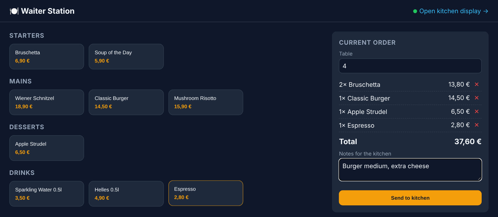
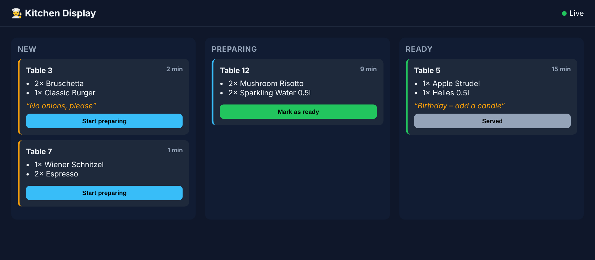
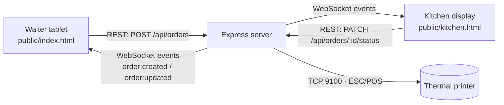

# 🍽️ Restaurant POS & Kitchen Display System

> A lightweight, real-time point-of-sale for small restaurants: waiters take orders on a tablet, the kitchen sees them instantly on a live display, and receipts are printed on standard ESC/POS thermal printers.


## The problem

Many small restaurants still rely on handwritten tickets: orders get lost, the kitchen has no overview of what is pending, and waiters walk back and forth to check whether a dish is ready. Commercial POS systems are often expensive and locked to proprietary hardware.

## The solution

This project is a minimal, self-hostable POS that runs on any laptop or Raspberry Pi in the restaurant's local network:

- **Waiter station** – tap menu items, set the table number, add kitchen notes and send the order.
- **Kitchen display (KDS)** – orders appear instantly in *New → Preparing → Ready* columns with a waiting-time timer.
- **Live feedback** – the waiter is notified as soon as the kitchen marks an order as ready.
- **Thermal printing** – each new order generates an 80 mm ESC/POS receipt sent to any network printer (port 9100). Without a printer, the receipt is simulated in the console.

## Screenshots

| Waiter station | Kitchen display |
|---|---|
|  |  |

## Architecture



| Layer | Responsibility |
|---|---|
| `src/orders.js` | Domain logic: validation, VAT calculation (prices in cents), order status state machine |
| `src/receipt.js` | 42-column receipt formatting, ESC/POS commands, network printing with timeout |
| `src/app.js` | Server factory: REST API, WebSocket broadcasting, centralised error handling |
| `src/server.js` | Entry point: reads environment variables and starts listening |
| `public/` | Framework-free frontend (vanilla JS modules + CSS) for the waiter and kitchen screens |

**Key design decisions**

- **Money as integers (cents)** to avoid floating-point rounding errors.
- **Explicit state machine** (`pending → preparing → ready → served`, with `cancelled`) so invalid transitions are rejected with HTTP 400.
- **Printing never blocks an order**: printer errors are logged, the order is still created and broadcast.
- **Server is the single source of truth**: clients only render what the server broadcasts, keeping all screens in sync.

## REST API

| Method | Endpoint | Description |
|---|---|---|
| `GET` | `/api/health` | Health check |
| `GET` | `/api/menu` | List menu items |
| `GET` | `/api/orders?active=true` | List (active) orders |
| `POST` | `/api/orders` | Create an order `{ table, items: [{ menuItemId, quantity }], notes }` |
| `PATCH` | `/api/orders/:id/status` | Move an order to the next status `{ status }` |

WebSocket events: `orders:snapshot`, `order:created`, `order:updated`.

## Getting started

**Prerequisites:** Node.js 20 or newer.

```bash
git clone https://github.com/leandromerov/restaurant-pos-order-system.git
cd restaurant-pos-order-system
npm install
cp .env.example .env      # optional: configure port, VAT rate and printer
npm run dev
```

- Waiter station: <http://localhost:3000>
- Kitchen display: <http://localhost:3000/kitchen.html>

Open both pages side by side and send an order to see the real-time updates.

### Environment variables

| Variable | Default | Description |
|---|---|---|
| `PORT` | `3000` | HTTP port |
| `VAT_RATE` | `0.19` | VAT rate included in menu prices |
| `PRINTER_HOST` | *(empty)* | IP of a network thermal printer. Leave empty to simulate printing |
| `PRINTER_PORT` | `9100` | Raw printing port |

### Run the tests

```bash
npm test
```

Node's built-in test runner covers the domain logic, receipt formatting and the REST API end to end (the server starts on a random port, and the tests drive a full order lifecycle). CI runs the suite on Node 20 and 22 on every push.

## Roadmap

- [ ] Persist orders in PostgreSQL (Prisma)
- [ ] Authentication and roles (waiter / kitchen / manager)
- [ ] Daily sales report and CSV export
- [ ] Split bills and card payments

## Author

**Leandro Romero Villalobos** · IT Analyst & Programmer · Passau, Germany
[GitHub](https://github.com/leandromerov) · leandroromerovillalobos@gmail.com

## License

[MIT](LICENSE)
